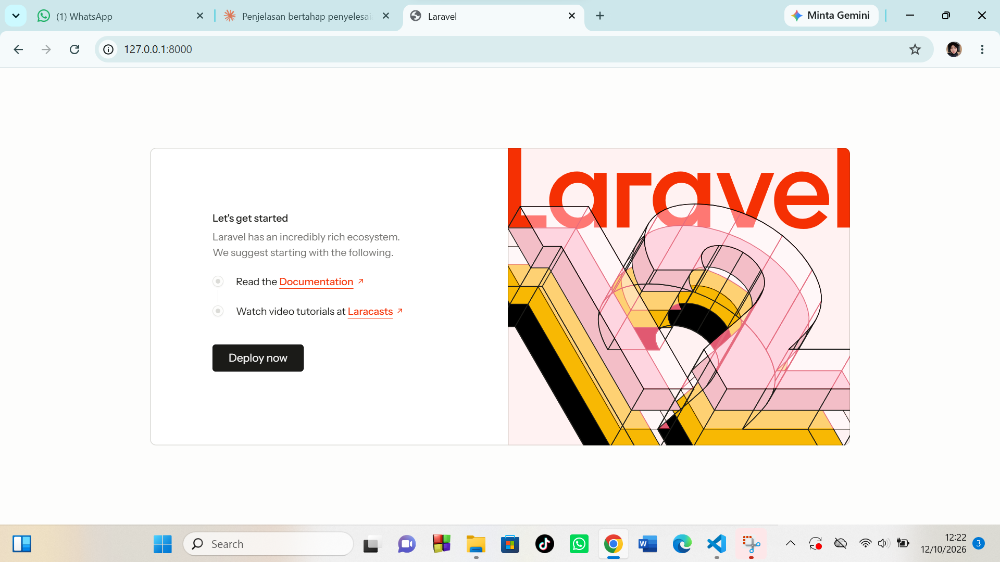

# Tugas Rutin 9 — Setup Laravel

Project Laravel 12 untuk Tugas Rutin Pertemuan 9.

**Nama:** Selvira Triana

## Fitur yang Dikerjakan

- Instalasi Laravel 12 lewat Composer
- Koneksi database MySQL (`tugasweb_p9`) lewat file `.env`
- 3 route custom (`/`, `/about`, `/contact`) yang menampilkan view Blade
- Data dinamis dikirim dari controller ke view (array)
- `make:controller` (PageController) dan `make:model -m` (Product + migration)

## Screenshot

Welcome page Laravel saat `php artisan serve` berjalan:



## Langkah Install

1. Pastikan sudah terpasang **PHP 8.2+**, **Composer**, dan **XAMPP** (Apache + MySQL).
2. Buat project:
```
   composer create-project laravel/laravel:^12.0 TugasWeb-P9-LaravelSetup
```
3. Masuk ke folder project:
```
   cd TugasWeb-P9-LaravelSetup
```
4. Nyalakan **Apache** dan **MySQL** di XAMPP, lalu buat database `tugasweb_p9` di phpMyAdmin (`http://localhost/phpmyadmin`).
5. Atur koneksi database di file `.env`:
```
   DB_CONNECTION=mysql
   DB_HOST=127.0.0.1
   DB_PORT=3306
   DB_DATABASE=tugasweb_p9
   DB_USERNAME=root
   DB_PASSWORD=
```
6. Jalankan migrasi untuk membuat tabel:
```
   php artisan migrate
```
7. Jalankan server:
```
   php artisan serve
```
8. Buka `http://127.0.0.1:8000` di browser.

## Daftar Route

| URL        | Controller               | View                |
|------------|--------------------------|---------------------|
| `/`        | `PageController@home`    | `home.blade.php`    |
| `/about`   | `PageController@about`   | `about.blade.php`   |
| `/contact` | `PageController@contact` |